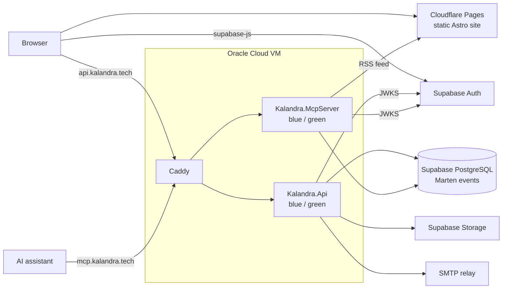

# Architecture

> How kalandra.tech is built today and why. Product scope is in
> [product-requirements.md](../product-requirements.md). These docs describe the current
> state and are rewritten in place when it changes — git holds the history.

## Overview

The website is a static Astro site on Cloudflare Pages; everything dynamic goes through one
ASP.NET Core backend on an Oracle Cloud VM. The backend has two front doors onto the same domain
code: the REST API that the site's own pages call, and an MCP server that AI assistants connect
to. Both store state as Marten events in Supabase's PostgreSQL, trust Supabase Auth's tokens, and
keep files in Supabase Storage. Notification emails go out from the API through an SMTP relay.
Cloudflare sits in front of everything; on the VM a shared Caddy proxy routes each hostname to
the live blue/green slot.

## Technical requirements

- **Cost** — as close to free as possible: free tiers for the static hosting, VM, database, auth,
  and error tracking.
- **Reliability** — the site stays up through deploys and host reboots without anyone logging in.
- **Automation** — every deploy runs from GitHub Actions; the only manual work is one-time host and
  account setup.
- **Long-running backend** — the backend runs continuous background work (event subscriptions),
  so it needs an always-on host, not a scale-to-zero platform.
- **Security** — only the reverse proxy is reachable from the internet, and only through
  Cloudflare; secrets live in GitHub and the VM's environment files, never in git.
- **Clients** — current desktop and mobile browsers; any MCP client that speaks streamable HTTP and
  OAuth 2.1.

## Local vs production

`aspire run` brings up the whole stack locally; see [local-development.md](local-development.md).

| Component | Local | Production |
| --- | --- | --- |
| Static site | Astro dev server, proxying `/api` to the API | Cloudflare Pages |
| REST API and MCP host | Aspire-launched projects | Rootless podman blue/green slots behind Caddy |
| Event store | Aspire-owned PostgreSQL container, one per worktree | Supabase PostgreSQL |
| Auth and file storage | Supabase CLI stack, seeded with a dev admin | Supabase project |
| Email | Supabase CLI's Mailpit catches backend and auth mail | SMTP relay (Brevo) |
| CAPTCHA | Cloudflare Turnstile always-pass test keys | Turnstile production keys |
| Telemetry | Aspire dashboard; frontend errors also reach Sentry's `development` environment | Sentry |

## Capabilities

- [Backend](backend.md) — the backend projects, the two hosts, and where new code goes
- [Persistence](persistence.md) — the Marten event store, streams, concurrency, and file storage
- [Auth](auth.md) — Supabase Auth, roles, token validation, and bot protection
- [Job offers](job-offers.md) — the hire-me flow: submission, review, history, and comments
- [Blog](blog.md) — posts as pages, languages, the feed, reactions, views, and comments
- [Notifications](notifications.md) — durable notification emails from event subscriptions
- [MCP server](mcp-server.md) — the AI-assistant front door and its OAuth flow
- [Frontend](frontend.md) — static generation, routing and i18n, and interactive islands
- [Deployment](deployment.md) — hosting, the shared VM, blue/green releases, and CI/CD
- [Observability](observability.md) — errors, traces, and logs in Sentry
- [Local development](local-development.md) — the local stack, stand-ins, seed data, and test tiers

Coding rules per layer are in [`docs/conventions/`](../conventions/); host runbooks sit next
to their unit files in [`infra/host/`](../../infra/host/).
